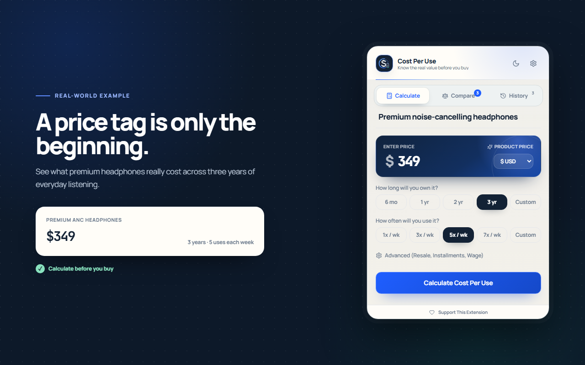
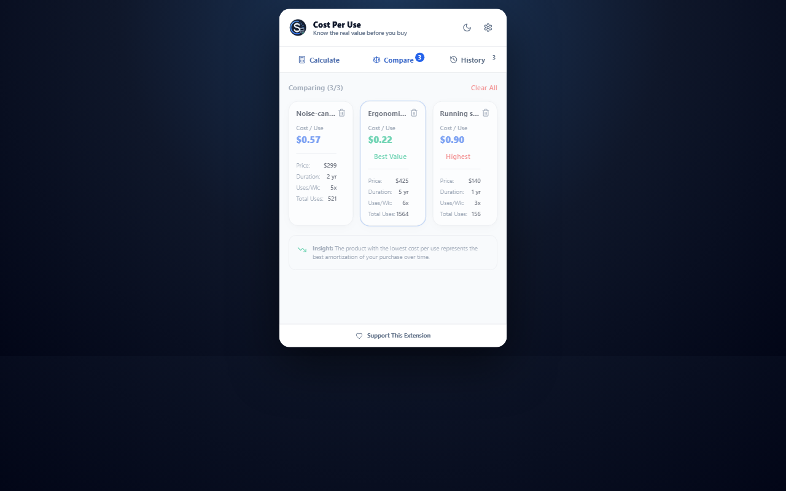
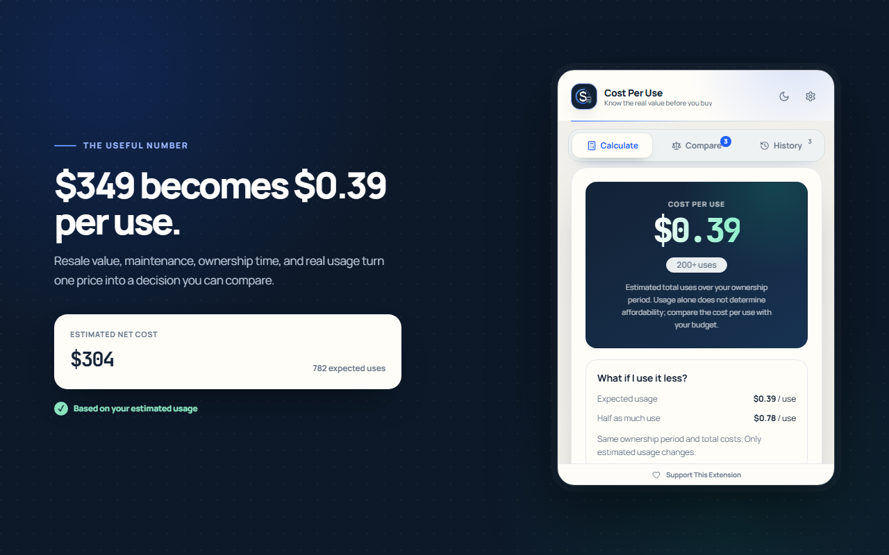
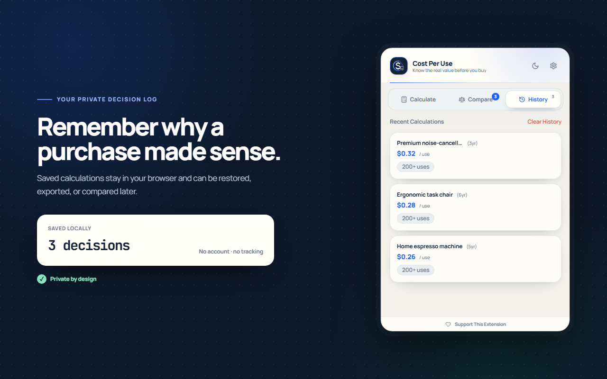

<p align="center">
  
</p>

<h1 align="center">Cost Per Use — Chrome & Edge Extension</h1>

<p align="center">
  <strong>Make smarter buying decisions. Calculate the real value of any purchase before you spend.</strong>
</p>

<p align="center">
  <a href="https://chromewebstore.google.com/detail/cost-per-use/kchaaggejdclkmjgfjbdjimmmjibllmd"></a>
  <a href="https://tahsinsoyak.github.io/cost-per-use-extension/"></a>
  <a href="https://github.com/tahsinsoyak/cost-per-use-extension/releases/latest"></a>
  <a href="LICENSE"></a>
  <a href="docs/privacy-policy.md"></a>
</p>

<p align="center">
  <a href="https://chromewebstore.google.com/detail/cost-per-use/kchaaggejdclkmjgfjbdjimmmjibllmd"><strong>👉 Add to Chrome (Free)</strong></a> •
  <a href="https://tahsinsoyak.github.io/cost-per-use-extension/"><strong>🌐 Try Interactive Web App</strong></a> •
  <a href="https://github.com/tahsinsoyak/cost-per-use-extension/releases/latest"><strong>📦 Download v1.1.0 ZIP</strong></a> •
  <a href="#-supported-languages"><strong>🌍 10 Languages</strong></a>
</p>

---

## 💡 Why Cost Per Use?

Price tags are deceptive. An expensive item you use every day often costs **far less** than a cheap impulse buy you only use twice.

```text
  ❌ $180 Party Shoes     worn 3 times         ➔  $60.00 / wear   (Wasteful)
  ✅ $300 Winter Coat     worn 200 days        ➔  $1.50 / wear    (Great deal!)
  ✅ $800 Daily Laptop    used 3 years daily   ➔  $0.73 / day     (Best investment!)
```

**Cost Per Use** sits right in your browser. Whenever you're browsing an online shop, open the extension to instantly evaluate whether a purchase is truly worth your hard-earned money.

---

## ✨ Features

- ⚡ **1-Click Shopping Autofill** — Automatically grabs product title, price, and currency when shopping on Amazon, eBay, Trendyol, Hepsiburada, and more.
- 🎯 **Target Cost Goal** — Set your personal cost-per-use goal (e.g. *$0.50/use*) to see the exact number of uses required to justify the price.
- ⚖️ **Side-by-Side Comparison** — Compare up to 3 products simultaneously to discover which one offers the highest value.
- 🔄 **Realistic "What-If" Scenarios** — Automatically calculates what happens if you only use the item half as much as anticipated.
- 🛠️ **Real Net Cost** — Factor in expected resale value, maintenance costs, and installment interest.
- ⏳ **Work-Hour Equivalent** — Translate price tags into hours of labor based on your wage.
- 💾 **Local History & JSON Export** — Save past calculations, export them for backup, or import previous logs.
- 🎨 **Dark & Light Modes** — Automatically conforms to your browser theme.
- 🔒 **100% Private & Offline** — No sign-up, no analytics, no remote servers, no trackers. All data stays strictly on your machine.

---

## 📸 Screenshots

<p align="center">
  
  
</p>
<p align="center">
  
  
</p>

---

## 🌍 Supported Languages

Cost Per Use is fully translated and accessible across 10 languages:

| Language | Code | Native Name | Status |
|---|:---:|---|:---:|
| 🇺🇸 English | `en` | English | ✅ Full |
| 🇹🇷 Turkish | `tr` | Türkçe | ✅ Full |
| 🇪🇸 Spanish | `es` | Español | ✅ Full |
| 🇩🇪 German | `de` | Deutsch | ✅ Full |
| 🇫🇷 French | `fr` | Français | ✅ Full |
| 🇧🇷 Portuguese | `pt-BR` | Português (Brasil) | ✅ Full |
| 🇷🇺 Russian | `ru` | Русский | ✅ Full |
| 🇸🇦 Arabic | `ar` | العربية (RTL) | ✅ Full |
| 🇯🇵 Japanese | `ja` | 日本語 | ✅ Full |
| 🇨🇳 Simplified Chinese | `zh-CN` | 简体中文 | ✅ Full |

---

## 🚀 How to Install

### Option 1: Chrome Web Store (Recommended)
Install directly in one click from the official store:
👉 **[Cost Per Use on Chrome Web Store](https://chromewebstore.google.com/detail/cost-per-use/kchaaggejdclkmjgfjbdjimmmjibllmd)**  
*(Also works seamlessly on Microsoft Edge, Brave, Opera, and Vivaldi)*

### Option 2: Prebuilt Release ZIP
1. Download the latest `cost-per-use-extension-v1.1.0.zip` from [GitHub Releases](https://github.com/tahsinsoyak/cost-per-use-extension/releases/latest).
2. Unzip the file into a folder.
3. Open `chrome://extensions/` and toggle **Developer mode** in the top right.
4. Click **Load unpacked** and choose the unzipped folder.

### Option 3: From Source
```bash
git clone https://github.com/tahsinsoyak/cost-per-use-extension.git
cd cost-per-use-extension
npm install
npm run build
```
Load the generated `dist/` directory as an unpacked extension.

---

## 💻 Tech Stack

- **Extension Framework:** Manifest V3 (Chrome & Edge compatible)
- **Frontend:** React 18 + TypeScript + Vite
- **Styling:** Tailwind CSS + PostCSS
- **State Management:** Zustand
- **Storage:** `chrome.storage.local` (zero cloud dependencies)
- **Testing:** Vitest (226 unit and localization tests)

---

## 🔒 Privacy & Permissions

Your privacy is paramount. **Cost Per Use** operates completely offline inside your browser:
- **No analytics or telemetry**
- **No tracking cookies or ads**
- **No account or registration required**
- **No data leaves your device**

Read our complete [Privacy Policy](docs/privacy-policy.md).

---

## 🤝 Contributing & Releases

- **Releases:** Check out the [Releases page](https://github.com/tahsinsoyak/cost-per-use-extension/releases) and [CHANGELOG.md](CHANGELOG.md) for full version history.
- **Pull Requests:** Issues and PRs are welcome! Before submitting changes, run:
  ```bash
  npm test
  npm run release:check
  ```

---

## ☕ Support

Cost Per Use is 100% free, open-source, and ad-free. If this extension saves you money and helps you shop smarter, consider supporting development:

[](https://www.patreon.com/tahsinsoyak)

---

<p align="center">
  Crafted with care by <a href="https://github.com/tahsinsoyak">@tahsinsoyak</a> • Licensed under <a href="LICENSE">MIT</a>
</p>
